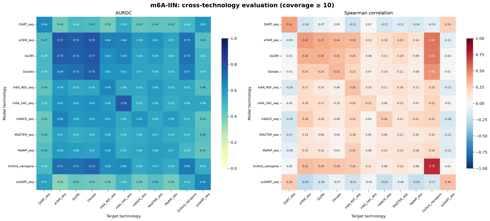

# m6A-IIN: Quantitative Cross-Technology Evaluation

Research adaptation of the m6A-IIN architecture for predicting site-level m6A modification proportions and assessing cross-technology generalisation. This private repository contains analysis code, HPC job templates, the recorded aggregate evaluation, and a reproducible plotting script.

> **Protocol distinction:** the original paper focuses on binary classification. This project adapts the architecture to quantitative regression with a binomial objective; results should not be described as a direct reproduction of the paper's classification benchmark. See [architecture audit](docs/AUTHOR_FIDELITY_AUDIT.md).

## Workflow

1. Prepare 41-nt sequence windows and matching site-level counts and fixed train/validation IDs.
2. Precompute RNA secondary-structure inputs and author-style ELMo features.
3. Train one model per technology using valid sites with `Total > 0`; select checkpoints by validation binomial negative log-likelihood.
4. Generate predictions for eligible sites, excluding each source model's own training and validation IDs.
5. Join predictions to target-technology labels and compute metrics on sites with `Total >= 10`.
6. Summarise same-technology holdout and cross-technology results separately.

The detailed input contracts, commands and important caveats are described in [the protocol notes](docs/IIN_SENIOR_PROTOCOL_README.md). Some paths and helper names in those notes are historical: inspect scripts and Slurm templates before running them.

## Model and objective

The implementation combines sequence-derived representations, pretrained ELMo features and structure/graph components from the audited author architecture. A scalar output is transformed by sigmoid into a predicted modification proportion. Training uses a binomial negative log-likelihood from modified and total read counts. This objective and the fixed-split evaluation differ from the original paper's classification setting.

## Recorded HPC results

Rows are source models and columns are target technologies. Diagonal entries are **same-technology holdout**, while off-diagonal entries are labelled cross-technology OOD in the recorded evaluation. Metrics apply the `Total >= 10` coverage filter after prediction. Overlap and dependence across technologies should be audited before treating these as fully independent external tests.

The saved aggregate for off-diagonal pairs reports mean AUROC **0.554**, AUPRC **0.319**, Spearman **0.085**, Pearson **0.089**, and R² **−23.841**. These are unweighted descriptive averages over available pairs, not confidence intervals. Large negative R² values can strongly affect the mean, especially when target variance is small. AUPRC also depends on target prevalence; several cross-technology correlations are negative. The results indicate substantial variability and should not be presented as uniformly strong generalisation.

The full aggregate table includes per-pair sample counts and all five metrics: [evaluation table](results/IIN_OOD_metrics.csv), [cross-technology summary](results/IIN_OOD_metrics_summary.csv). Recreate the figure with `python plot_results.py` after installing pandas, seaborn and matplotlib.

## Repository guide

- `train_IIN.py`, `train_IIN_cap10.py`: training variants; confirm the selected experiment and settings before use.
- `OOD_IIN.py`, `evaluate_OOD_IIN.py`: prediction and subsequent metric calculation.
- `iin_protocol_common.py`, `m6a_iin_forward_regression.py`: data and model components.
- `precompute_author_elmo_direct.py`, `tools/preprocessing/`: feature preparation.
- `jobs/`: HPC Slurm templates, with environment- and cluster-specific paths.
- `author_original/`: included author-source snapshot used for comparison; review its upstream licensing and provenance before redistribution.
- `docs/`: protocol and architecture audit notes.
- `results/`, `figures/`: recorded aggregate metrics and visualisation; individual predictions and checkpoints are excluded.

## Requirements and reproducibility

The workflow requires Python, PyTorch and scientific Python packages, RNAfold, and compatible pretrained ELMo resources. The sequence FASTA, fixed splits, technology ground-truth files, feature caches, and model checkpoints are not included. HPC paths and environments in scripts need adaptation; versions are not pinned. Run the provided small checks and inspect the data contract before launching full preprocessing or training. No complete independent rerun is claimed here.

The repository combines the local September 2026 snapshot with selected later HPC updates to the common/model code and additional diagnostic/training scripts. Confirm versions against the relevant HPC job configuration before interpreting or rerunning a specific experiment.

## Reference

Original model: [ZLSRW/m6A-IIN](https://github.com/ZLSRW/m6A-IIN), *Communications Biology* 8, 1022 (2025). This repository is an adaptation and is not the original authors' release.
